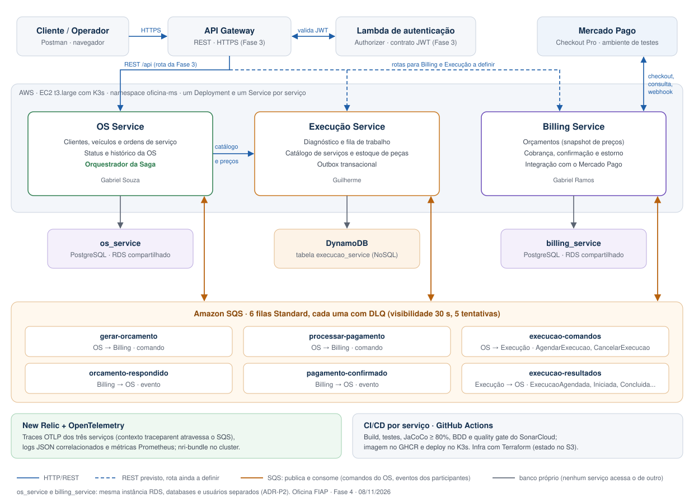
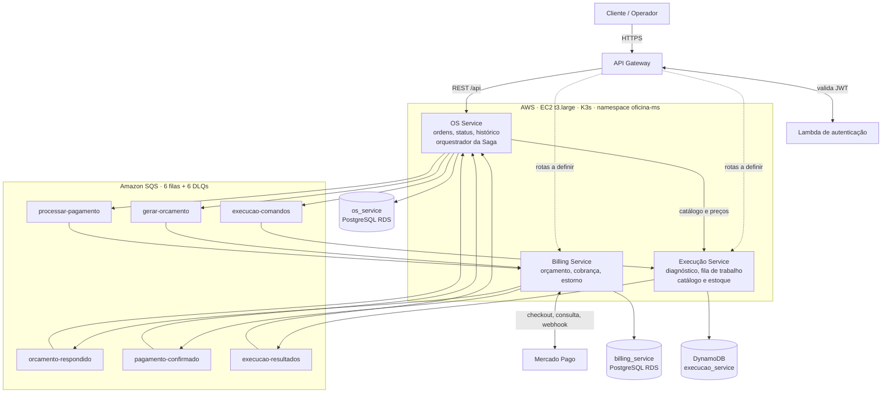

# Arquitetura geral da Fase 4

Visão da solução inteira: os três microsserviços, os bancos de cada um e como eles se comunicam. As decisões por trás deste desenho estão nos [ADRs da Fase 4](decisoes-fase4/README.md).

Atualizado em 08/11/2026, com o que já está implementado e o que ainda está previsto (indicado em cada ponto).

O arquivo [`arquitetura-geral-fase4.svg`](arquitetura-geral-fase4.svg) é a versão em imagem, para o PDF de entrega. A mesma visão em Mermaid, editável:

## Serviços

| Serviço | Responsabilidade | Banco | Repositório |
| --- | --- | --- | --- |
| **OS Service** | Clientes, veículos, ordens de serviço, status e histórico. **Orquestrador da Saga** (ADR-P4). | PostgreSQL `os_service` (RDS) | [oficina-fiap-os-service](https://github.com/pisanohub/oficina-fiap-os-service) |
| **Billing Service** | Orçamento com snapshot de preços, cobrança no Mercado Pago, confirmação e estorno. | PostgreSQL `billing_service` (RDS) | [oficina-fiap-billing-service](https://github.com/pisanohub/oficina-fiap-billing-service) |
| **Execução Service** | Diagnóstico, fila de trabalho, início e conclusão do reparo, catálogo de serviços e estoque de peças. | DynamoDB `execucao_service` | [oficina-fiap-execucao-service](https://github.com/pisanohub/oficina-fiap-execucao-service) |

**Bancos (ADR-P2):** cada serviço tem o seu e nenhum acessa o de outro. OS e Billing usam databases e usuários separados na mesma instância RDS (isolamento lógico, com menos custo no AWS Academy). O Execução usa DynamoDB, o banco NoSQL exigido pelo desafio. Ali, o estado da execução varia (diagnóstico com versões, reservas, outbox), e o serviço gerenciado evita manter um banco dentro do cluster.

## Comunicação

### Assíncrona: Amazon SQS (ADR-P3)

A Saga usa só filas. O OS envia comandos e os participantes respondem com eventos. Todas as filas são Standard, com DLQ, visibilidade de 30 s e 5 tentativas antes da DLQ.

| Fila | De → para | Mensagens |
| --- | --- | --- |
| `gerar-orcamento` | OS → Billing | `GerarOrcamento` (com o preço dos itens já embutido) |
| `orcamento-respondido` | Billing → OS | `OrcamentoGerado` |
| `processar-pagamento` | OS → Billing | `ProcessarPagamento` |
| `pagamento-confirmado` | Billing → OS | `PagamentoConfirmado` |
| `execucao-comandos` | OS → Execução | `AgendarExecucao`, `CancelarExecucao` |
| `execucao-resultados` | Execução → OS | `ExecucaoAgendada`, `ExecucaoRejeitada`, `ExecucaoIniciada`, `ExecucaoConcluida`, `ExecucaoCancelada`, `CancelamentoExecucaoRecusado` |

Como o SQS Standard pode entregar a mesma mensagem mais de uma vez, os consumidores são idempotentes (pelo `operationId`). Os eventos são publicados por **outbox**: gravados na mesma transação da mudança de estado e enviados depois, para não perder nem inventar eventos.

### Síncrona: REST

| Quem chama | Destino | Para quê | Situação |
| --- | --- | --- | --- |
| Cliente e operador | API Gateway → OS | Abrir e consultar ordens | Rota da Fase 3; ajuste para o OS novo em andamento |
| Operador | API Gateway → Execução | Diagnóstico, catálogo, estoque, iniciar e concluir o reparo | Rota a definir |
| Cliente | API Gateway → Billing | Consultar orçamento e pagamento | Rota a definir |
| OS | Execução | Consultar catálogo e preços ao montar a OS (snapshot do preço) | Contrato publicado pelo Execução |
| Billing | Mercado Pago | Checkout, consulta do pagamento e estorno | Implementado no Billing |
| Mercado Pago | Billing | Webhook de notificação do pagamento | Implementado no Billing |

O Billing **não** chama o Execução: o preço vem no comando do OS (ADR-P4). As chamadas síncronas entre serviços usam Circuit Breaker onde existem (ADR-P7).

## Saga orquestrada (ADR-P4)

O OS Service orquestra: guarda o estado da Saga no próprio banco e decide o próximo comando a cada evento. A escolha da orquestração (e não da coreografia) concentra o fluxo num lugar só. Assim fica mais fácil depurar, testar e demonstrar, e saber em que passo cada OS está.

Fluxo feliz:

1. Durante o diagnóstico, os serviços e as peças da OS são definidos com o preço do catálogo do Execução.
2. `SolicitarOrcamento` (ação explícita) → `GerarOrcamento` → Billing → `OrcamentoGerado` → OS em `AGUARDANDO_APROVACAO`.
3. Cliente aprova → `ProcessarPagamento` → Billing cobra no Mercado Pago → `PagamentoConfirmado`.
4. `AgendarExecucao` → Execução reserva as peças e cria a execução → `ExecucaoAgendada`.
5. O mecânico inicia e conclui o reparo → `ExecucaoIniciada` e `ExecucaoConcluida` → OS `CONCLUIDA` → `ENTREGUE`.

Compensações:

| Falha | Compensação |
| --- | --- |
| Pagamento recusado | Cancelar o orçamento e a OS, sem agendar a execução |
| Execução rejeitada (falta de peça) | Estornar o pagamento e cancelar a OS. O Execução não reserva nada parcialmente. |
| Cancelamento antes do início do reparo | `CancelarExecucao` → `ExecucaoCancelada`, com as peças devolvidas ao estoque; depois o estorno |
| Cancelamento depois do início | `CancelamentoExecucaoRecusado`: o trabalho feito não é desfeito automaticamente |

## Infraestrutura e plataforma

| Item | Decisão |
| --- | --- |
| Cluster | EC2 `t3.large` com K3s e Elastic IP fixo (ADR-P5). Namespace `oficina-ms`, um Deployment e um Service (`ClusterIP`) por serviço. |
| Infra como código | Terraform com estado no S3: cluster (`oficina-fiap-infra-k8s`, inclui as filas SQS), RDS (`oficina-fiap-infra-database`). |
| CI/CD | Pipeline próprio por serviço no GitHub Actions: build, testes, JaCoCo com mínimo de 80%, BDD, quality gate do SonarCloud, imagem no GHCR e deploy no K3s. |
| Entrada e autenticação | API Gateway e Lambda de autenticação da Fase 3 (RFC-001/002). |
| Observabilidade | New Relic com OpenTelemetry (ADR-004, estendido na ADR-P6). Traces OTLP com o contexto atravessando o SQS (`traceparent` nos atributos da mensagem), logs JSON com `trace.id`, e métricas Prometheus coletadas pelo `nri-bundle`. |
