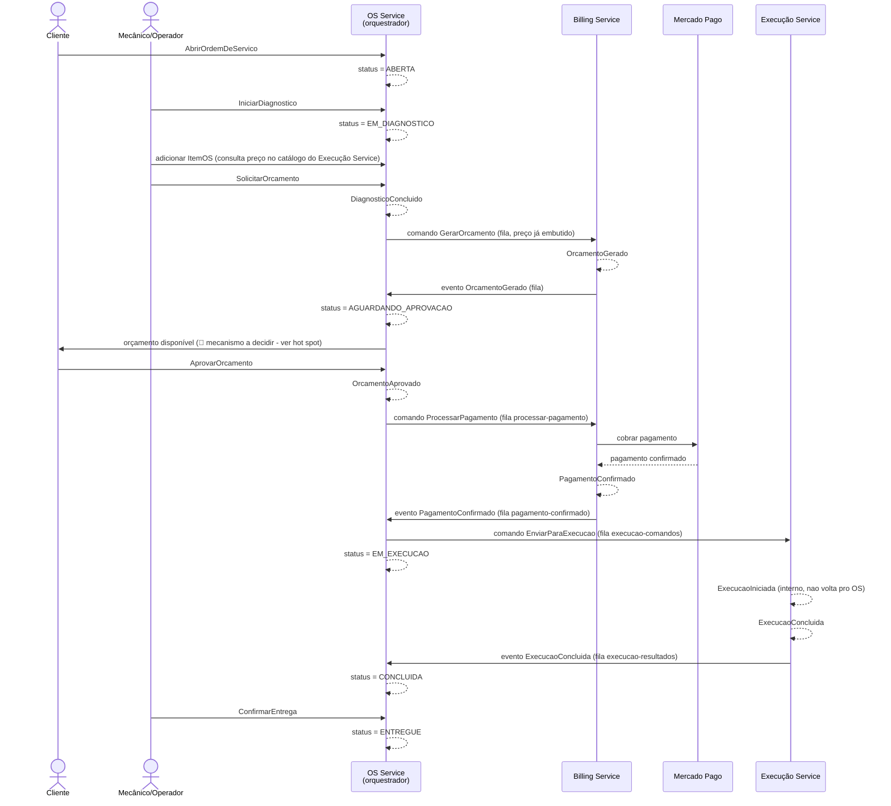

# Event Storming — Saga da Ordem de Serviço (v1, rascunho)

Rascunho inicial pra refinar com o grupo (item da Semana 0 do `divisao-tarefas-fase4.md`). Cobre o caminho feliz e os caminhos de compensação aprovados na reunião de 15/10/2026.

## Legenda (pra quem não usou Event Storming antes)

| Elemento | O que é | Convenção |
|---|---|---|
| 🟧 **Evento de domínio** | Um fato que já aconteceu. Sempre no passado. | `OrcamentoGerado`, `PagamentoRecusado` |
| 🟦 **Comando** | Uma ação/intenção, no imperativo. Dispara um evento quando bem-sucedido. | `GerarOrcamento`, `ProcessarPagamento` |
| 🟪 **Política** | Regra "quando [evento], então [comando]" — é o que conecta um evento ao próximo comando, atravessando os serviços. | "Quando `OrdemDeServicoAberta`, então `GerarOrcamento`" |
| 🟨 **Agregado** | A entidade "dona" do evento, responsável por garantir suas regras de negócio. | `OrdemDeServico`, `Orcamento`, `Execucao` |
| 🧍 **Ator** | Quem inicia uma ação externamente. | Cliente |
| 🟥 **Sistema externo** | Fora dos nossos serviços. | Mercado Pago |
| 🔴 **Hot spot** | Pergunta em aberto ou ponto de atrito a resolver com o grupo. | ver seção final |

## Linha do tempo — caminho feliz

| # | 🟦 Comando | 🟨 Agregado / Serviço | 🟧 Evento resultante | 🟪 Política (reação) |
|---|---|---|---|---|
| 1 | `AbrirOrdemDeServico` (ator: Cliente) | `OrdemDeServico` / OS Service | `OrdemDeServicoAberta` | status vira `ABERTA` — sem fila ainda |
| 2 | `IniciarDiagnostico` (ator: Mecânico/Operador) | `OrdemDeServico` / OS Service | `DiagnosticoIniciado` | status vira `EM_DIAGNOSTICO`; itens (`ItemOS`) são adicionados nesse status — é aqui que o preço de cada item é capturado do catálogo do Execução Service (ver hot spot #2, resolvido) |
| 3 | `SolicitarOrcamento` (ator: Mecânico/Operador) | `OrdemDeServico` / OS Service | `DiagnosticoConcluido` | Quando `DiagnosticoConcluido` → disparar `GerarOrcamento` (fila `gerar-orcamento`) |
| 4 | `GerarOrcamento` | `Orcamento` / Billing Service | `OrcamentoGerado` | Quando `OrcamentoGerado` → OS Service publica na fila `orcamento-respondido`; status da OS vira `AGUARDANDO_APROVACAO` |
| 5 | `AprovarOrcamento` (ator: Cliente) | `OrdemDeServico` / OS Service | `OrcamentoAprovado` | Quando `OrcamentoAprovado` → disparar `ProcessarPagamento` (fila `processar-pagamento`) |
| 6 | `ProcessarPagamento` | `Pagamento` / Billing Service (🟥 integra com Mercado Pago) | `PagamentoConfirmado` | Quando `PagamentoConfirmado` → OS Service consome a fila `pagamento-confirmado`; disparar `EnviarParaExecucao` (fila `execucao-comandos`) |
| 7 | `EnviarParaExecucao` | `Execucao` / Execução Service | `ExecucaoIniciada` | Status da OS vira `EM_EXECUCAO` **imediatamente ao disparar** o comando — não espera confirmação. `ExecucaoIniciada` é só interno do Execução Service, nunca é publicado de volta pro OS (decisão confirmada em 07/11/2026, ver hot spot #6) |
| 8 | `ConcluirExecucao` | `Execucao` / Execução Service | `ExecucaoConcluida` | Quando `ExecucaoConcluida` → OS Service publica na fila `execucao-resultados`; status da OS vira `CONCLUIDA` |
| 9 | `ConfirmarEntrega` (ator: Mecânico/Operador) | `OrdemDeServico` / OS Service | `OrdemDeServicoEntregue` | Status vira `ENTREGUE` — **ação explícita**, não dá pra automatizar: representa a entrega física do veículo ao cliente, um evento do mundo real que nenhuma fila consegue detectar sozinha (resolvido em 07/11/2026, ver hot spot #6). Fim do fluxo feliz |

## Linha do tempo — compensações (caminhos de falha)

| Gatilho (🟧 evento de falha) | 🟦 Comando de compensação | 🟨 Agregado / Serviço | 🟧 Evento resultante |
|---|---|---|---|
| `OrcamentoReprovado` (ator: Cliente reprova) | `CancelarOrdemDeServico` | `OrdemDeServico` / OS Service | `OrdemDeServicoCancelada` |
| `PagamentoRecusado` (Mercado Pago recusa) | `CancelarOrdemDeServico` | `OrdemDeServico` / OS Service | `OrdemDeServicoCancelada` |
| `ExecucaoFalhou` (ex.: falta de peça, fila indisponível) | `EstornarPagamento` **então** `CancelarOrdemDeServico` | `Pagamento` / Billing Service → `OrdemDeServico` / OS Service | `PagamentoEstornado` → `OrdemDeServicoCancelada` |

> Nota da P7: a etapa de orçamento/pagamento no Billing Service deve aplicar Pessimistic View ou Reread Value antes de confirmar `PagamentoConfirmado`, pra evitar condição de corrida se o cliente aprovar enquanto outro processo mexe no mesmo orçamento.

## Diagrama de sequência (caminho feliz)

## Hot spots — perguntas em aberto pro grupo

1. **Contrato dos eventos:** schema exato do payload de cada mensagem SQS (campos obrigatórios, versionamento). Precisa ser combinado antes de cada dupla começar a implementar sua ponta — é o mesmo tipo de problema que travou a Fase 3 (contrato do JWT divergente entre Lambda e app).
2. ~~**Consulta síncrona Billing → Execução**~~ — **RESOLVIDO (02/11/2026):** sem chamada síncrona. O preço de cada `Servico`/`ItemEstoque` já é capturado pelo OS Service **no momento em que o item é adicionado à OS** (reaproveitando o campo `ItemOS.precoUnitario`, que já existia no monólito) — nesse momento o OS Service consulta o catálogo do Execução Service. Esse preço (um "snapshot") vai embutido no próprio comando `gerar-orcamento`, então o Billing nunca precisa chamar o Execução Service na hora de montar o orçamento — elimina a dependência síncrona entre os dois serviços durante a saga. Trade-off aceito: se o catálogo mudar de preço depois que o item já foi colocado na OS, o orçamento usa o valor congelado no momento da adição — comportamento desejado pro domínio (o cliente não deve ver o preço mudar depois de já ter colocado o item na ordem). Proposta a formalizar no ADR-P4 (Saga orquestrada, Gabriel Souza).
3. **Onde mora o estado da Saga:** um campo de status na própria `OrdemDeServico`, ou uma tabela separada dedicada a acompanhar "em que passo está essa Saga" (mais rastreável, mas mais uma tabela pra manter)?
4. **Timeout de aprovação:** o que acontece se o cliente nunca aprovar/reprovar o orçamento? Precisa de um evento de expiração?
5. **Como o cliente sabe que o orçamento está pronto pra aprovar:** hoje não existe nenhum mecanismo de notificação — a aplicação sempre funcionou por consulta (`GET /api/v1/ordens/cliente/{clienteId}`). Mantemos assim (cliente consulta quando quiser) ou adicionamos alguma notificação ativa (e-mail/push)? Não é exigido pelo enunciado da Fase 4, então é uma decisão de escopo, não só técnica.
6. ~~**Gatilho de `EM_EXECUCAO` e do status `ENTREGUE`**~~ — **RESOLVIDO (07/11/2026)**, dúvidas do Gabriel Souza:
   - `EM_EXECUCAO`: a OS muda pra esse status **imediatamente ao disparar** o comando `EnviarParaExecucao`, sem esperar confirmação — `ExecucaoIniciada` nunca foi desenhado pra voltar pro OS (é interno do Execução Service). Considerado criar um `AGUARDANDO_EXECUCAO` intermediário (simétrico ao `AGUARDANDO_APROVACAO`), mas descartado por ora: a DLQ já cobre falha de entrega de mensagem, e a granularidade extra não compensa o trabalho em dois serviços a essa altura do projeto.
   - `ENTREGUE`: diferente dos outros status, **não dá pra automatizar por fila** — representa a entrega física do veículo, um evento do mundo real. Precisa de um endpoint explícito (`ConfirmarEntrega`), chamado manualmente pelo operador quando o cliente retira o veículo.
