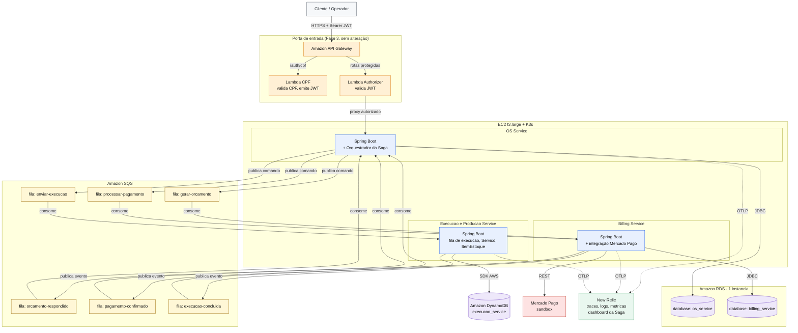

# Rascunho individual — Arquitetura Fase 4 (Pedro)

Rascunho pessoal para a "lição de casa" combinada na reunião de 15/10/2026. Reflete as premissas P1–P7 já validadas pelo grupo.

## Fluxo da Saga (texto, pra acompanhar o diagrama)

1. Cliente abre OS → **OS Service** cria o registro e dispara comando `gerar-orcamento` pro Billing (via SQS).
2. **Billing Service** gera o orçamento, publica evento de resposta. OS fica `AGUARDANDO_APROVACAO`.
3. Cliente aprova → **OS Service** dispara comando `processar-pagamento` pro Billing (via SQS) → Billing processa pagamento via Mercado Pago (sandbox) → publica evento de confirmação na fila `pagamento-confirmado`.
4. **OS Service** consome `pagamento-confirmado`, dispara comando `enviar-execucao` pro Execução Service (via SQS).
5. **Execução Service** processa (usa o catálogo `Servico`/`ItemEstoque` que hoje vivem nele) e publica evento de conclusão.
6. **OS Service** recebe o evento, atualiza o status pra `CONCLUIDA` → `ENTREGUE`.

Compensações: pagamento recusado → Billing publica evento de rejeição → OS Service cancela a OS. Falha ao enfileirar execução → OS Service dispara comando de estorno pro Billing.

## Pontos que ainda quero confirmar com o grupo

- Nome exato das filas SQS e formato do payload dos eventos (schema/contrato).
- Se o Billing precisa consultar o catálogo (`Servico`) no Execução Service via REST síncrono na hora de gerar o orçamento, ou se recebe esses dados junto no comando inicial do OS Service.
- Onde fica o estado da máquina de Saga dentro do OS Service (campo de status na própria `OrdemDeServico`, ou uma tabela separada de acompanhamento da Saga).
